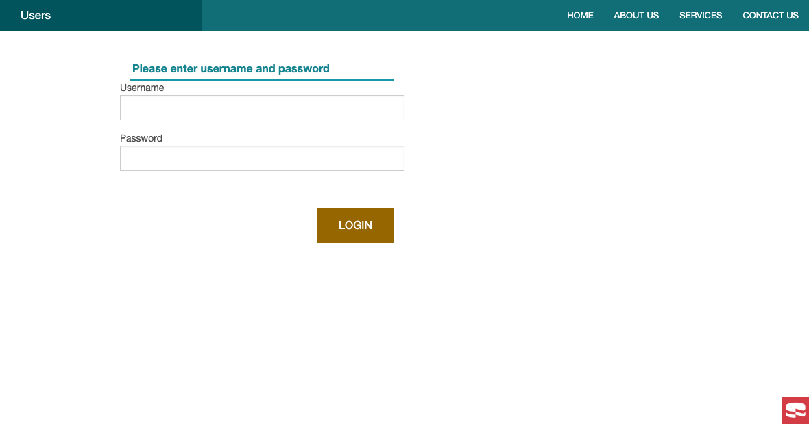
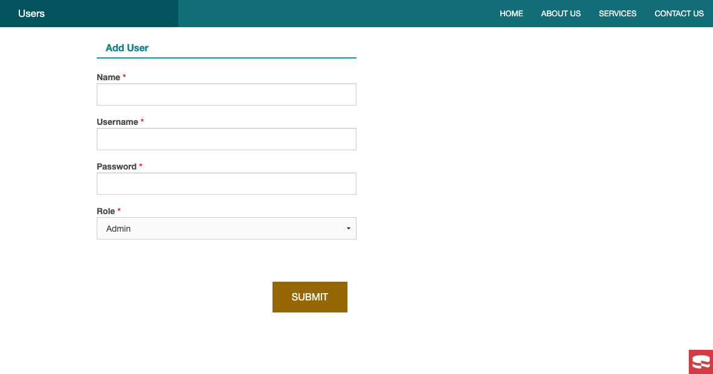
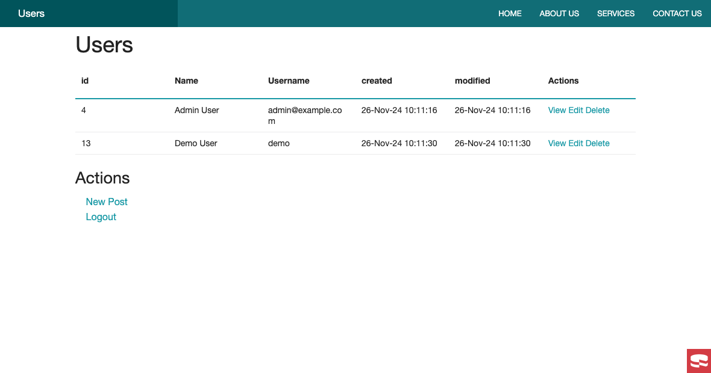
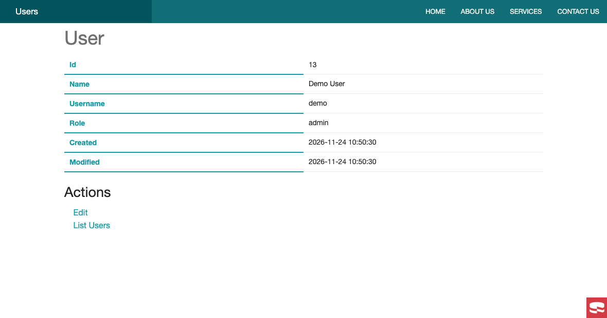

# <a href="https://github.com/gowthamand/cakephp-login-register-crud">CakePHP CRUD, Login, Register, Dashboard</a>

[](#)
[](#)
[](#)
[](#)

<a href="https://cakephp-login-register-crud.vercel.app/"> <b>Live Demo</b></a>

## Key Features

- Register / Login / Logout
- User CRUD (create, list, view, edit, delete)
- Form validation and roles (admin / author)
- Passwords hashed with bcrypt
- Data stored in **Redis**, no MySQL needed
- Sessions stored in Redis, so logins survive serverless cold starts
- Runs locally with **Docker**, deploys to **Vercel**

## Tech Stack

| Layer | Technology |
|---|---|
| Framework | CakePHP 3.5 |
| Language | PHP 7.4 |
| Database | Redis over its REST API |
| Sessions | Redis (custom `SessionHandlerInterface`) |
| Local runtime | Docker (`php:7.4-apache`) |
| Hosting | Vercel (`vercel-php@0.3.6`) |

## Data Model (Redis)

All keys are prefixed with `ck_`.

| Key | Type | Description |
|---|---|---|
| `ck_users:{id}` | string (JSON) | id, name, username, password (bcrypt), role, created, modified |
| `ck_users:usernames` | hash | username → user id (unique lookup) |
| `ck_users:ids` | set | all user ids |
| `ck_users:seq` | counter | next user id |
| `ck_sessions:{id}` | string | PHP session payload, with TTL |

## Configuration

Settings come from environment variables. Never commit the real token.

| Variable | Required | Default |
|---|---|---|
| `REDIS_REST_URL` | ✅ | none |
| `REDIS_REST_TOKEN` | ✅ | none |
| `SECURITY_SALT` | ✅ in production | `__SALT__` |
| `DEBUG` | | `true` |

The older `UPSTASH_REDIS_REST_URL` / `UPSTASH_REDIS_REST_TOKEN` names still work as a fallback.

## Run Locally (Docker)

```bash
git clone https://github.com/gowthamand/cakephp-login-register-crud
cd cakephp-login-register-crud

cp .env.example .env        # then set REDIS_REST_URL and REDIS_REST_TOKEN in .env
docker compose up --build
```

Open http://localhost:8765 — the home page is the login screen.

Register the first account at http://localhost:8765/users/add

Generate a production salt with:

```bash
openssl rand -hex 32
```

## Deploy to Vercel

1. Import the repository in Vercel. `vercel.json` handles the runtime and routing.
2. Under **Settings → Environment Variables**, add `REDIS_REST_URL`, `REDIS_REST_TOKEN`,
   `SECURITY_SALT` and `DEBUG=false`.
3. Redeploy, since variables only apply to new deployments.

## Routes

| Route | Description |
|---|---|
| `/` | Login page |
| `/users/add` | Register |
| `/users` | User list (requires login) |
| `/users/view/{id}` | User details |
| `/users/edit/{id}` | Edit user |
| `/users/delete/{id}` | Delete user (POST) |
| `/users/logout` | Logout |

## Project Structure

```
src/Model/Redis/RedisClient.php      Redis REST client (env vars)
src/Model/Redis/RedisUserStore.php   Users on Redis
src/Auth/RedisAuthenticate.php       Login against Redis
src/Network/Session/RedisSession.php Sessions on Redis
src/Controller/UsersController.php   Register, login, CRUD
src/Template/Users/                  add, edit, index, view, login
config/routes.php                    Routes ( / → login )
api/index.php                        Vercel entrypoint
vercel.json                          Vercel runtime and routes
Dockerfile, docker-compose.yml       Local Docker setup
```

## Screenshots

**Login**


**Register**


**Users List**


**User Details**


## ⭐ Don't forget to give a star and fork!
